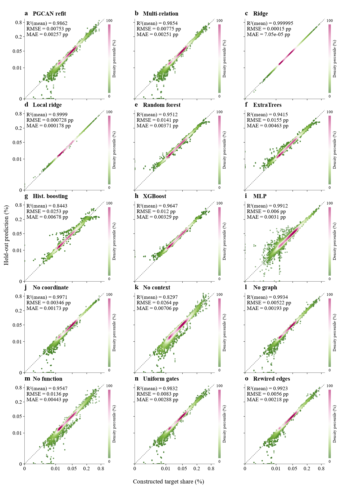
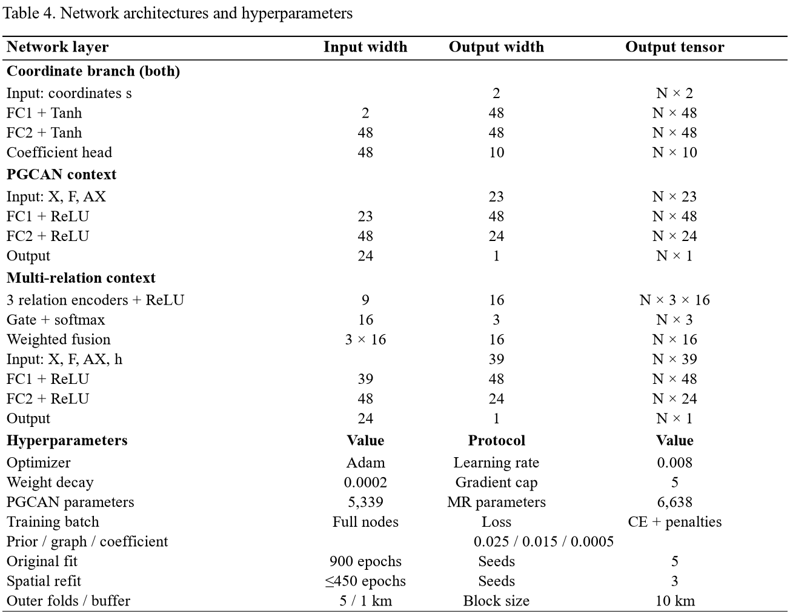

# PGCAN: prior-guided spatial carbon allocation

Author code and reproducible results for **Evaluating spatial graph learning
for proxy-supervised carbon allocation**. The manuscript is a work in progress;
this repository is not a claim of publication or state-of-the-art performance.

## What is implemented

1. Six predictor scores and five operational classes define a normalized prior.
2. The supervision target is `t = 0.70 prior + 0.30 activity`.
3. Coordinates feed a 2–48–48–10 Tanh network; its outputs form nine spatial
   coefficients and an intercept. A 23–48–24–1 ReLU context branch receives
   nine predictors, five class indicators and nine spatial aggregates.
4. Residuals modify the log prior, followed by across-cell softmax and allocation
   of an **adopted** 15 Mt regional amount. No measured grid-emissions label is used.
5. A separate multi-relation candidate has spatial, functional and built/activity
   relations, three 9–16 encoders, adaptive relation gates and a 39-input context head.

**Original framework vs new benchmarks:** the published editable framework
depicts the original five-seed, 900-epoch PGCAN only. Its symmetric 8NN graph,
self-loops and symmetric degree normalization differ deliberately from the
train-only row-normalized query graphs used for buffered spatial refits.
New refits use five 10 km spatial folds, a 1 km centroid buffer and three seeds,
with inner validation selecting at most 450 epochs. See `docs/FRAMEWORK_CODE_AUDIT.md`.

## Quick verification with real released results

```console
python -m pip install -e .
python scripts/recompute_metrics.py
python -m unittest discover -s tests
```

The verification recomputes all 15 Figure 13 panels from the released arrays.
Direct-share ridge outperforms the neural models on the constructed target;
graph ablations and rewiring controls are retained, including unfavourable results.
Benchmark site lists are used for location screening, never for fitting or
epoch selection. The regulatory (146) and energy-user (69) cohorts share 59 sites.

## Retrain the original framework

Supply an authorized predictor matrix conforming to `data/input_schema.json`:

```console
python -m pgcan --predictors data/local/predictors_only.csv --output outputs/original
```

Defaults reproduce the original architecture and training settings. Reproducing
numerical results also requires the exact input snapshot and runtime versions.
A shortened run is a smoke test only, not a manuscript result.

## Full experimental and visualization code

`analysis/` contains the actual original implementation, spatial benchmarks,
direct-share baselines, channel decomposition, sensitivity, source removal,
all figure generators, cartographic preparation and layer/parameter tables.
For full spatial experiments, install `.[experiments,figures]`, place authorized
original inputs in a local project tree, and set `PGCAN_PROJECT_ROOT` to that tree.
`PGCAN_FONT_DIR` can point to a legally installed Times New Roman font directory.
Import private working assets locally using `scripts/import_local_workspace.py`.

Execute in order:
```console
python analysis/run_model_benchmark.py
python analysis/run_direct_baselines.py
python analysis/deep_model_analysis.py
python analysis/refine_palette_and_maps.py
```
The existing corrected input directory must contain `experiment_core.py`,
`predictors_only.csv`, `allocation_500m.csv` and authorized evaluation inputs.
Plotting also requires the documented source-data and basemap assets. Full
retraining/plot regeneration is **not self-contained** without those inputs.

## Current Figure 13 design

Figure 13 places the PGCAN, multi-relation and ridge comparison first,
then the remaining baselines and six controls. It plots every real paired
cell once per saved seed without sampling or jitter, with metrics in each panel's upper-left
corner and one scatter per configuration. Colour is the within-panel percentile of a
bivariate Gaussian KDE (Scott bandwidth), **not a bin count or an error sign**.
The individual vertical bars show 0–100 density percentile. Numerical ties
use log density rounded to ten decimals before average-rank assignment.
Scatter positions are actual seed-specific OOF predictions: three per cell for
stochastic methods and one for deterministic methods (81,180 marks total).
These repeat predictions of the same 1,980 cells, not independent observations.
Identical axes use asinh(share percentage / 0.001), with ticks in raw percentages.
Larger translucent markers expose genuine seed variation; no artificial spread is added.
R², RMSE and MAE still use the seed-mean ensemble and are unchanged.
Displayed metrics use three decimals; positive errors below 0.001 are
shown as <0.001. The pp unit means percentage points, not relative percent
change. Values rounded to R² = 1.000 need not be mathematically exact.
Scientific results in v0.1.0 remain valid; v0.1.1 includes the current figure design.



## Compact architecture table

The presentation separates layer names, input/output widths and output tensors,
with grouped coordinate, PGCAN and multi-relation blocks and compact settings.
It adapts the layout of the author-supplied GTCNNWR table; all values are from
this implementation. Registered counts remain 5,339 and 6,638. The complete
layer parameter ledger and the display table are in `data/results/`.



## Current public release

Version **0.1.1** includes the current research and visualization code, anonymous
results, and verification records. Coverage bars use one solid colour per row,
progressing from pink to green; no bar has an internal colour gradient. Enlarged
intersection panels and the annotated category-error matrix are retained.
See [public repository scope](docs/PUBLIC_SCOPE.md) for the included materials
and the separation from private manuscript production and collaborator data.

## Data, citations and licenses

Author code: MIT. Anonymous author-generated numerical outputs: CC BY 4.0.
Raw POI records, enterprise lists, commercial basemap tiles, licensed fonts,
cited PDFs and third-party reference code are not bundled. See `data/README.md`.
The input schema is included; model predictions are actual results, not example data.

GNNWR means geographically neural network weighted regression, not a graph
neural network. PGCAN is a custom model, not a faithful implementation of GNNWR:
- Du et al. (2020), https://doi.org/10.1080/13658816.2019.1707834
- Yin et al. (2024), https://doi.org/10.5194/gmd-17-8455-2024

Runtime versions used for the recorded benchmarks are in `configs/protocol.json`.
Fixed configurations, descriptive fold/seed ranges and the deterministic proxy
limitation must be retained when interpreting or extending the results.
